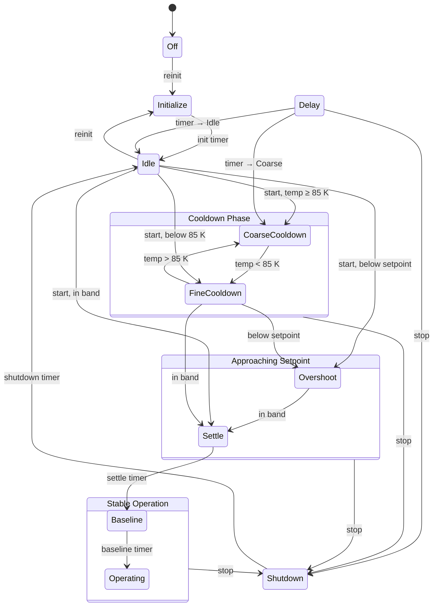
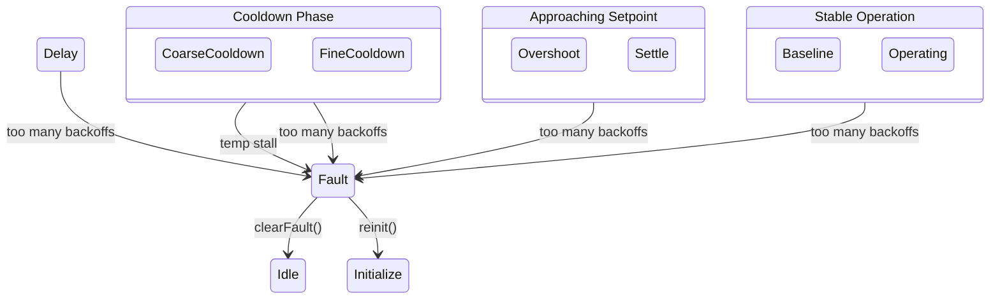

# Cryocooler State Machine

## Diagram

### Normal Operation Flow

`start()` selects the resume state from `tempK` and is valid from both **Off**
and **Idle**; only the Idle transitions are shown to reduce clutter.  `Delay`
is reachable from any non-Fault state via `startDelay()` — see
[Global Transitions](#global-transitions-any-state).

### Fault Conditions

Three fault types — **RMS overvoltage**, **low system voltage**, and **state
oscillation** — fire from *any* non-Fault state and are listed in the
[Global Transitions](#global-transitions-any-state) table.  The diagram below
shows the state-specific faults; composite groupings match the normal-flow
diagram.

---

## Global Transitions (any state)

These transitions originate from all non-Fault states and are omitted from the
diagram above to keep it readable.

| Trigger | Condition | To | FaultReason |
|---|---|---|---|
| `off()` | — | Off | — |
| RMS overvoltage | `amplifier RMS V > AMPLIFIER_MAX_VOLTAGE` | Fault | `RmsOvervoltage` |
| Low system voltage | `systemVoltage > 0` and `systemVoltage < MIN_SYSTEM_VOLTAGE_VDC` | Fault | `LowSystemVoltage` |
| State oscillation | FSM alternates between same two states >= `FSM_OSCILLATION_MIN_CYCLES` times within `FSM_OSCILLATION_WINDOW_MS` | Fault | `StateOscillation` |
| `startDelay()` | — | Delay | — |

---

## State Reference

| State | Value | Relay | FAULT indicator | READY indicator | DAC target |
|---|:-:|---|---|---|---|
| Off | -1 | Bypass | Off | Off | 0 |
| Initialize | 0 | Bypass | Solid Amber | Solid Amber | 0 |
| Idle | 1 | Bypass | Solid Red | Off | 0 |
| CoarseCooldown | 2 | Bypass | Flash Fast Red | Off | proportional to temp |
| FineCooldown | 3 | Bypass | Flash Fast Red | Flash Slow Green | proportional to temp |
| Overshoot | 4 | Bypass | Flash Fast Red | Flash Fast Green | 0 |
| Settle | 5 | **Normal** | Flash Fast Red | Flash Fast Green | 0 |
| Baseline | 6 | **Normal** | Off | Solid Green | 0 |
| Operating | 7 | **Normal** | Off | Solid Green | 0 |
| Shutdown | 8 | Bypass | Off | Off | ramping to 0 (fast) |
| Delay | 9 | Bypass | Solid Amber | Solid Amber | 0 |
| Fault | 127 | Bypass + **Alarm** | Flash Fast Red | Off | 0 |

The DAC target is computed proportional to how far `tempK` has dropped from
`AMBIENT_START_K` toward `SETPOINT_K`, less the accumulated overstroke backoff
(see Behavioural Notes), and is only non-zero during
CoarseCooldown and FineCooldown.  The amplifier ramps toward the target each
tick; Shutdown uses a faster ramp rate via `amplifier::rampTowardShutdown()`.

---

## Fault Reference

| FaultReason | Value | Trigger | Originating states |
|---|:-:|---|---|
| RmsOvervoltage | 1 | `amplifier::getLastRmsVoltage() > AMPLIFIER_MAX_VOLTAGE` | Any non-Fault |
| TemperatureStall | 2 | Stall-detect window expired without sufficient temp drop | CoarseCooldown, FineCooldown |
| TooManyBackoffs | 3 | `backoffCount >= BACKOFF_MAX_COUNT` | All running states |
| LowSystemVoltage | 4 | `systemVoltage < MIN_SYSTEM_VOLTAGE_VDC` (0.0 ignored) | Any non-Fault |
| StateOscillation | 5 | FSM oscillation detector fired | Any non-Fault |
| SensorFault | 6 | `cold_head::hasSensorFault()`, or the amplifier RMS voltage / current reading is missing (NaN) | All running states |

Fault is a **terminal state**. The only exits are `clearFault()` to Idle and
`reinit()` to Initialize. Both paths reset `faultReason`, `backoffCount`, and
`backoffDacOffset`.

---

## Behavioural Notes

**start() resume logic** — The starting state is chosen from the current
cold-stage temperature so the system resumes correctly after a power cycle
without triggering spurious stall faults.  `start()` is valid from both Off
and Idle with identical temperature-based branching.

**Settle timer** — The timer only advances while the temperature is inside the
setpoint band (`SETPOINT_K +/- SETPOINT_TOLERANCE_K`).  Any excursion out of
band resets the timer to zero; the full `SETTLE_DURATION_MS` must elapse
continuously in-band before the transition to Baseline fires.

**Overstroke backoff** — Two independent detectors raise an overstroke event,
and `main.cpp` ORs them into `update()`'s `overstroke` argument:

- **IMU tap** (`imu::hasOverstroke()`): the LSM6DSOX single-tap interrupt on
  INT1 (2 g) sees the piston hitting its stop.  The accelerometer runs at
  3333 Hz so the tap detector sees impact vibration up to about 1.67 kHz.
- **Electrical** (`amplifier::hasElectricalOverstroke()`): the amplifier
  module estimates the motor back-EMF from the ACS37800 readings
  (`include/back_emf.h`).  With the current as phase reference,
  `E = (P/I - I*R) + j(Q/I - I*w*L)`, using `MOTOR_COIL_RESISTANCE_OHM` and
  `MOTOR_COIL_INDUCTANCE_H`; the sign of Q comes from the chip's POSANGLE bit.
  At a fixed drive frequency `|E|` is proportional to piston stroke.  The
  estimate is smoothed over `BACK_EMF_SMOOTHING_MS` and is not reported below
  `BACK_EMF_MIN_CURRENT_A`.  Two checks can trip, at most once per
  `BACK_EMF_HOLDOFF_MS`:
  - smoothed `|E|` above `BACK_EMF_LIMIT_VRMS`;
  - load impedance `V / I` falling more than
    `BACK_EMF_IMPEDANCE_DROP_FRACTION` below its slow baseline (a piston that
    hits its stop loses velocity, so back-EMF and impedance drop suddenly).

  **Both thresholds are 0 (off) in `config.h` until they are set from measured
  runs**; the estimate is still reported as `amplifier.back_emf_v`.  The serial
  command `set bemf limit <V>` applies a temporary limit that can only tighten
  the check, for testing the trip at a safe drive level.

Each event, while running, increments `backoffCount`, steps the DAC down by
`BACKOFF_DAC_STEP` at once, and lowers the cooldown drive target by the
accumulated `backoffDacOffset`.  Events less than `BACKOFF_MIN_INTERVAL_MS`
(200 ms) after the last one count once.  Like the OEM controller's back-off
counter (US6098409 FIG 5C, `docs/oem-controller/analysis/OVERSTROKE.md`), the
offset holds for `BACKOFF_HOLD_MS` (30 s) after the last event, then decays
with time constant `BACKOFF_DECAY_TAU_MS` (10 s), so the drive recovers once
overstrokes stop.  `backoffCount` does not decay: at `BACKOFF_MAX_COUNT` events
since `start()` the `TooManyBackoffs` fault is raised.  The offset and counter
both reset on `start()`, `clearFault()` and `reinit()`.
With `BACKOFF_MONITOR_WHEN_STOPPED` (on for bench testing), events while stopped
are also counted and decay the same way, so telemetry and the dashboard show
them; they never step the DAC or raise the fault, and `start()` clears them.

**Delay state** — A generic timed hold reachable from any non-Fault state via
`startDelay(nowMs, durationMs, nextState)`.  The destination is either Idle or
CoarseCooldown; any other value defaults to Idle.  `stop()` can interrupt a
pending delay.

**Fault is terminal** — The only exits are `clearFault()` to Idle and
`reinit()` to Initialize.  Both reset `faultReason`, `backoffCount`, and
`backoffDacOffset`; `reinit()` additionally re-runs all hardware module inits
via the registered `onInitializeCallback`.
