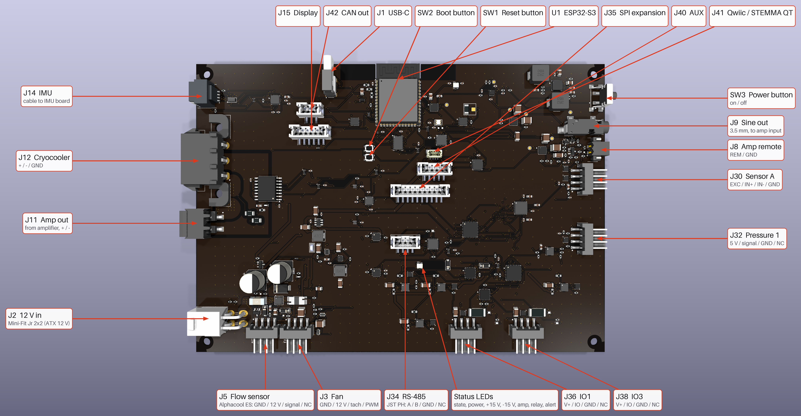
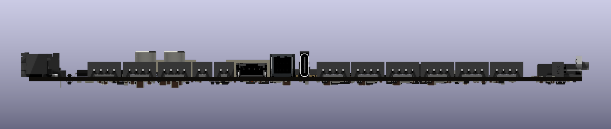
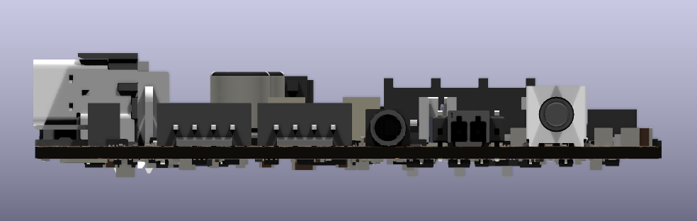
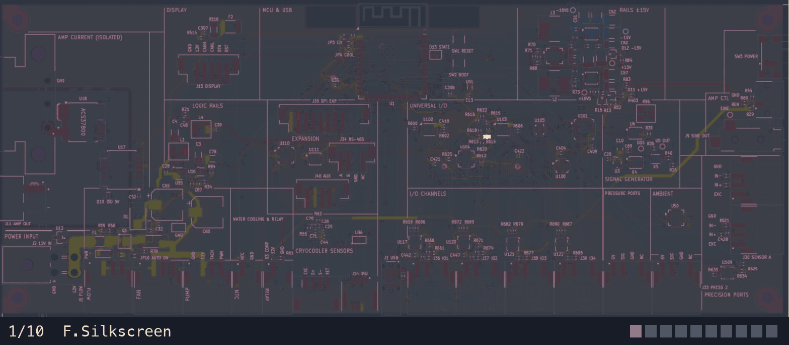

# Fabrication files

`cryocooler_jlcpcb.zip` is the upload for JLCPCB: Gerbers (Protel extensions, X2
attributes) and Excellon drill files (PTH and NPTH separate, mm, absolute origin)
made from `cryocooler.kicad_pcb` (rev 7: 4 layers, 170 x 120 mm, Phoenix UCS 195-145 housing). `gerbers/` holds the same
files plus the drill maps and report; nothing in it is hand-edited.

These files, the zip and the renders (`circuit-board-render-front.png`, `-back.png`, `-angle.png`
and the four edge views `-edge-top.png`, `-edge-bottom.png`, `-edge-left.png`, `-edge-right.png`)
are regenerated automatically by `tools/export_fab.py`,
which `gen_pcb.py` (every mode) and `link_usb_vbus.py` run after they write the board. After a
manual edit of `cryocooler.kicad_pcb` (for example a hand-routed fix), run it yourself:

```bash
python3 hardware/kicad/tools/export_fab.py     # needs kicad-cli; about 30 s
SKIP_FAB_EXPORT=1 ...                          # set this to skip the export while iterating
```

From the repo root, `make fab` does the same, and `make gerbers` writes only the Gerbers, drills
and zip (a few seconds, no renders). `make` lists the targets.

Zones must already be filled (the generators leave them filled). The Gerber headers carry a
creation date, so the files differ in git after every export even if the board did not change.

## Board renders




The front and back renders carry a callout for every connector, drawn by
`tools/render_callouts.py` (text in its `PORTS` table). Edge views, named for the
board edge facing the camera:







## Layer stack

Each layer from front to back (F.Silkscreen, F.Paste, F.Mask, F.Cu, In1.Cu, In2.Cu, B.Cu,
B.Mask, B.Paste, B.Silkscreen), plotted with the board outline and labelled. Regenerate it
after a layout change with `python3 hardware/kicad/tools/layer_stack_gif.py`
(`export_fab.py` does not write it).



## Order settings to check

* Rev 7: 4 layers, 170 x 120 mm, 1.6 mm, 1 oz copper, **black** solder mask, no
  impedance control. The layer count and size were read from the board (2026-11-23); the
  black mask (`MASK_COLOUR` in `tools/gen_pcb.py`), 1 oz and "no impedance control" are carried over from
  rev 6 and were not re-read from the board stackup.
* Design minimums: 0.15 mm track, 0.15 mm clearance everywhere (rev 5's 0.1 mm
  exceptions are gone), 0.2 mm smallest drill, 0.3 mm copper to board edge. A
  0.45 mm via with a 0.2 mm drill may sit 0.1 mm from a surface-mount pad
  (`via_in_pad_clearance`), and keeps 0.15 mm from tracks and other vias. JLCPCB's
  published 4-layer limits are 0.09 mm spacing and 0.1 mm pad to track; whether its
  0.2 mm via-to-track figure means the hole or the pad was not confirmed.
  The board has a routed notch in the top edge under the ESP32 antenna
  (74.5-93.5 x 0-6 mm), and the four corner squares around the mounting holes have
  no solder mask (housing requirement).
* **Via-in-pad:** many SMD pads carry vias: 199 via holes overlap an SMD pad of the same net, on 80 parts
  (measured with pcbnew, 2026-11-23: 0.45 / 0.2 mm 64, 0.5 / 0.3 mm 21, 0.6 / 0.3 mm 58, 0.7 / 0.35 mm 56), among them
  the exposed IC ground pads, the shunt, fuses and power-path parts. Order filled and capped vias, and check
  JLCPCB's current via limits first. The board has 2,068 vias: 990 of 0.45 mm with 0.2 mm drills,
  454 of 0.5 / 0.3 mm, 466 of 0.6 / 0.3 mm and 158 of 0.7 / 0.35 mm.
* **Filled and capped vias are required on the whole board:** part labels, pin names
  and section names print across vias, so an open via would break the text. Confirm
  the option covers every via.
* **ENIG finish:** for the fine-pitch leadless parts. Rev 5 has no mask-opening labels.
* **High-precision silkscreen printing:** part labels, pin names and the board ID block are not placed on rev 7 yet.
  When they are, they are 0.8 mm text with a 0.1 mm stroke, JLCPCB's published minimum for high-precision
  printing: select it and say in the order notes that the small text is intentional.
* Parts on both sides: 193 of the 506 footprints are on the back (measured). The CPL has 485 placements
  (296 top, 189 bottom); J2 and J12 are through-hole and not in it.
* The board ID block is not stamped yet (it waits for the user's review and commit). Rev 6 printed `REV6` in its place; whether any such text remains on this
  board was not checked.

The drill report (`gerbers/drill_report.txt`) lists every hole size. Plated holes: 0.2 mm 990 and 12, 0.3 mm 920,
0.35 mm 158 (the 0.2 / 0.3 / 0.35 mm via drills are 990, 920 and 158 of these; the other 12 at 0.2 mm are component
pads), then 0.6 mm (4 slots), 1.52 mm and 1.8 mm component holes; 2,091 in all. Unplated: 15, among them the four
3.2 mm mounting holes.
