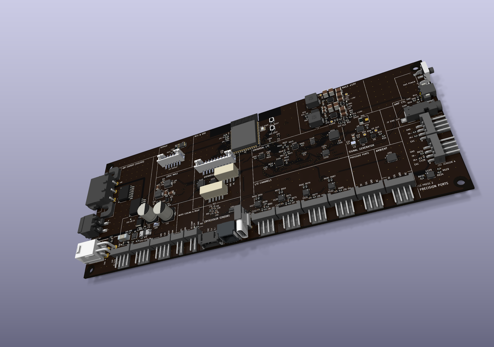
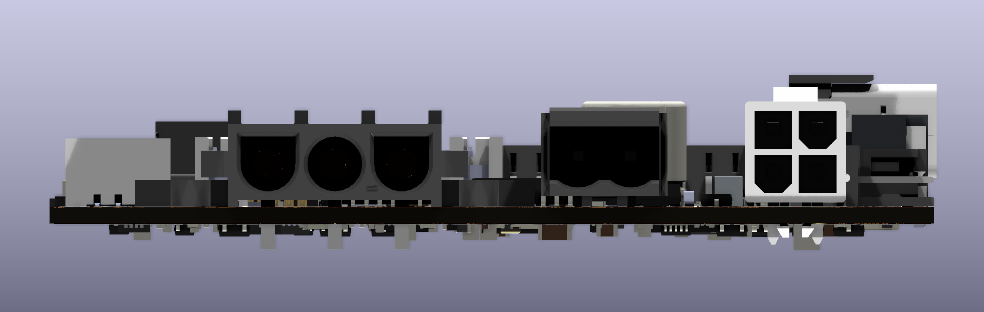

# Fabrication files

`cryocooler_jlcpcb.zip` is the upload for JLCPCB: Gerbers (Protel extensions, X2
attributes) and Excellon drill files (PTH and NPTH separate, mm, absolute origin)
made from `cryocooler.kicad_pcb` (4 layers, 120 x 100 mm, Phoenix UCS 145-125 housing). `gerbers/` holds the same
files plus the drill maps and report; nothing in it is hand-edited.

These files, the zip and the renders (`circuit-board-render-front.png`, `-back.png`, `-angle.png`
and the four edge views `-edge-top.png`, `-edge-bottom.png`, `-edge-left.png`, `-edge-right.png`)
are regenerated automatically by `tools/export_fab.py`,
which `gen_pcb.py` (every mode) and `link_usb_vbus.py` run after they write the board. After a
manual edit of `cryocooler.kicad_pcb` (for example a hand-routed fix), run it yourself:

```bash
python3 hardware/kicad/tools/export_fab.py     # needs kicad-cli; about 30 s
SKIP_FAB_EXPORT=1 ...                          # set this to skip the export while iterating
```

Zones must already be filled (the generators leave them filled). The Gerber headers carry a
creation date, so the files differ in git after every export even if the board did not change.

## Board renders




The front and back renders carry a callout for every connector, drawn by
`tools/render_callouts.py` (text in its `PORTS` table). Edge views, named for the
board edge facing the camera:





## Layer stack

Each layer from front to back (F.Silkscreen, F.Paste, F.Mask, F.Cu, In1.Cu, In2.Cu, B.Cu,
B.Mask, B.Paste, B.Silkscreen), seen from the front in the PCB editor with inactive layers
dimmed and power nets in their net-class colours. Captured by hand from KiCad, so
`export_fab.py` does not regenerate it: recapture it after a layout change.


## Order settings to check

* 4 layers, 120 x 100 mm, 1.6 mm, 1 oz copper, **black** solder mask, no impedance control.
* Design minimums: 0.15 mm track, 0.2 mm smallest drill, 0.5 mm board edge clearance.
  **Clearance is 0.15 mm except at 214 places between 0.10 and 0.15 mm** (track to
  track and track to pad on the I/O control lines, none below 0.10 mm and none at a
  0.3 mm-drill via; see `DESIGN_REVIEW.md`, "Rev 5 board"). JLCPCB's published 4-layer
  limits are 0.09 mm spacing and 0.1 mm pad to track; its 0.2 mm via-to-track figure
  was not confirmed, and the 0.2 mm-drill vias sit 0.1 mm from other copper.
  The board has a routed notch in the top edge under the ESP32
  antenna (74.5-93.5 x 0-6 mm), and the four corner squares around the mounting
  holes have no solder mask (housing requirement).
* **Via-in-pad:** 52 pads on 40 parts carry vias (48 vias of 0.45 mm with 0.2 mm
  drills, 12 of 0.6 mm with 0.3 mm drills). Order filled and capped vias, and check
  JLCPCB's current via limits first.
* **Filled and capped vias are required on the whole board:** part labels, pin names
  and section names print across vias, so an open via would break the text. Confirm
  the option covers every via.
* **ENIG finish:** for the fine-pitch leadless parts. Rev 5 has no mask-opening labels.
* **High-precision silkscreen printing:** 400 labels are 0.8 mm text with a 0.1 mm
  stroke, JLCPCB's published minimum for high-precision printing. Select it and say
  in the order notes that the small text is intentional.
* Parts on both sides: 236 of the 495 footprints are on the back.
* The back silkscreen carries `REV5` in place of the board ID block (top edge, beside
  the power input); check the viewer shows it mirrored correctly from the back.

The drill report lists every hole size: plated 0.2 mm (816), 0.3 mm (585),
component holes 0.6 to 1.8 mm; unplated 0.8 to 3.81 mm (15, among them the four
3.2 mm mounting holes).