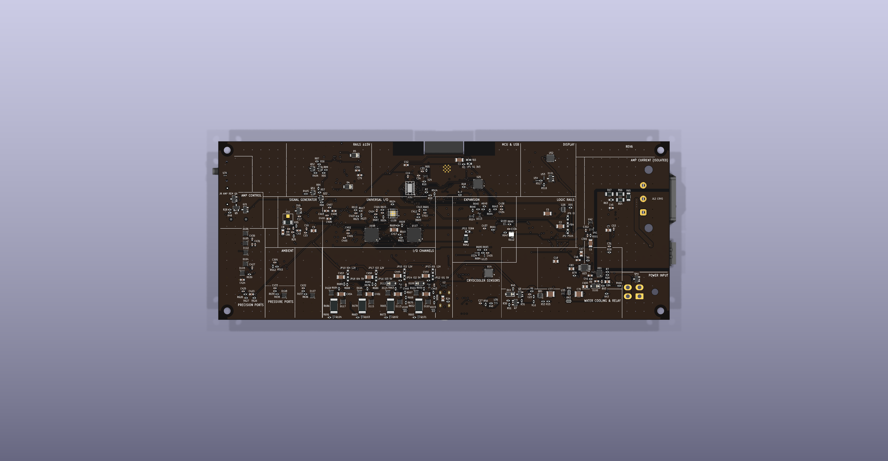
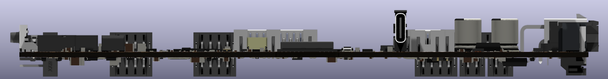

# Fabrication files

`cryocooler_jlcpcb.zip` is the upload for JLCPCB: Gerbers (Protel extensions, X2
attributes) and Excellon drill files (PTH and NPTH separate, mm, absolute origin)
made from `cryocooler.kicad_pcb` (4 layers, 120 x 100 mm, Phoenix UCS 145-125 housing). `gerbers/` holds the same
files plus the drill maps and report; nothing in it is hand-edited.

These files, the zip and the renders (`circuit-board-render-front.png`, `-back.png`, `-angle.png`
and the four edge views `-edge-top.png`, `-edge-bottom.png`, `-edge-left.png`, `-edge-right.png`)
are regenerated automatically by `tools/export_fab.py`,
which `gen_pcb.py` (every mode) and `link_usb_vbus.py` run after they write the board. After a
manual edit of `cryocooler.kicad_pcb` (for example a hand-routed fix), run it yourself:

```bash
python3 hardware/kicad/tools/export_fab.py     # needs kicad-cli; about 30 s
SKIP_FAB_EXPORT=1 ...                          # set this to skip the export while iterating
```

Zones must already be filled (the generators leave them filled). The Gerber headers carry a
creation date, so the files differ in git after every export even if the board did not change.

## Board renders





The front and back renders carry a callout for every connector, drawn by
`tools/render_callouts.py` (text in its `PORTS` table). Edge views, named for the
board edge facing the camera:




## Layer stack

Each layer from front to back (F.Silkscreen, F.Paste, F.Mask, F.Cu, In1.Cu, In2.Cu, B.Cu,
B.Mask, B.Paste, B.Silkscreen), seen from the front in the PCB editor with inactive layers
dimmed and power nets in their net-class colours. Captured by hand from KiCad, so
`export_fab.py` does not regenerate it: recapture it after a layout change.


## Order settings to check

* Rev 6: 4 layers, 212 x 84 mm, 1.6 mm, 1 oz copper, **black** solder mask, no
  impedance control.
* Design minimums: 0.15 mm track, 0.15 mm clearance everywhere (rev 5's 0.1 mm
  exceptions are gone), 0.2 mm smallest drill, 0.3 mm copper to board edge. A
  0.45 mm via with a 0.2 mm drill may sit 0.1 mm from a surface-mount pad
  (`via_in_pad_clearance`), and keeps 0.15 mm from tracks and other vias. JLCPCB's
  published 4-layer limits are 0.09 mm spacing and 0.1 mm pad to track; whether its
  0.2 mm via-to-track figure means the hole or the pad was not confirmed.
  The board has a routed notch in the top edge under the ESP32 antenna
  (96.5-115.5 x 0-6 mm), and the four corner squares around the mounting holes have
  no solder mask (housing requirement).
* **Via-in-pad:** the exposed IC ground pads, U36 pad 4 and U32 pad 19 carry vias.
  Order filled and capped vias, and check JLCPCB's current via limits first. The
  board has 1,442 vias: 1,075 of 0.45 mm with 0.2 mm drills, 364 of 0.6 / 0.3 mm
  and 3 of 0.7 / 0.35 mm.
* **Filled and capped vias are required on the whole board:** part labels, pin names
  and section names print across vias, so an open via would break the text. Confirm
  the option covers every via.
* **ENIG finish:** for the fine-pitch leadless parts. Rev 5 has no mask-opening labels.
* **High-precision silkscreen printing:** the part labels (424) and pin names are 0.8 mm text with a 0.1 mm
  stroke, JLCPCB's published minimum for high-precision printing. Select it and say
  in the order notes that the small text is intentional.
* Parts on both sides: 278 of the 497 footprints are on the back.
* The back silkscreen carries `REV6` in place of the board ID block (top edge, left); check the viewer shows it mirrored correctly from the back.

The drill report (`gerbers/drill_report.txt`) lists every hole size. The vias are
plated 0.2 mm (1,075), 0.3 mm (364) and 0.35 mm (3); the rest are component holes
and the unplated holes, among them the four 3.2 mm mounting holes.