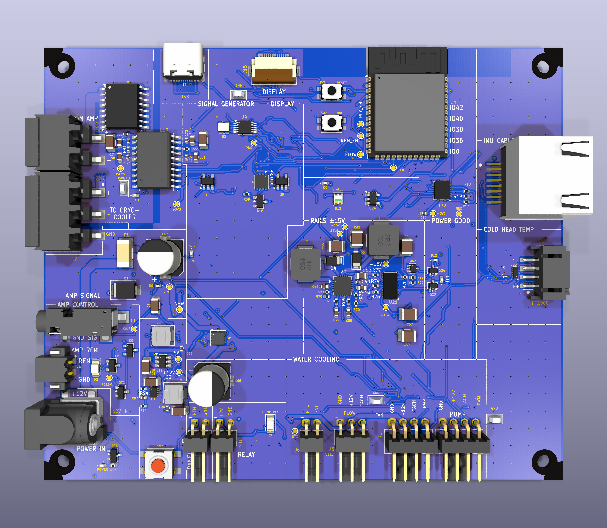
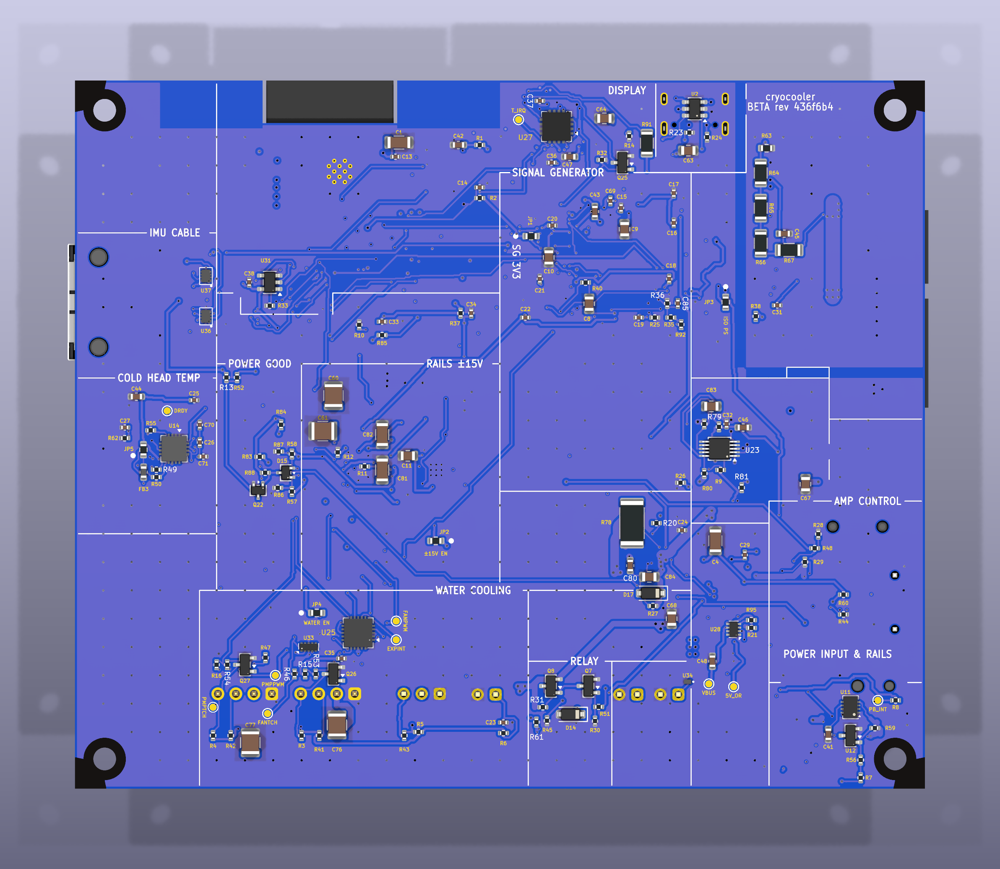
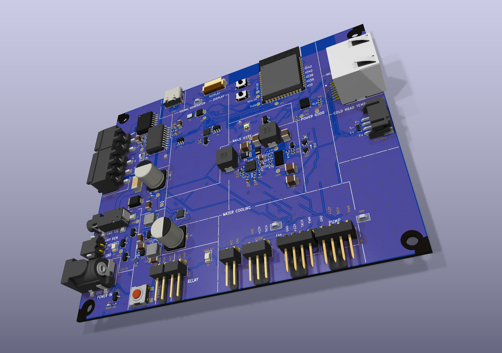

# Fabrication files

`cryocooler_jlcpcb.zip` is the upload for JLCPCB: Gerbers (Protel extensions, X2
attributes) and Excellon drill files (PTH and NPTH separate, mm, absolute origin)
made from `cryocooler.kicad_pcb` (4 layers, 120 x 100 mm, Phoenix UCS 145-125 housing). `gerbers/` holds the same
files plus the drill maps and report; nothing in it is hand-edited.

These files, the zip and the front / back / angled renders (`circuit-board-render-front.png`,
`circuit-board-render-back.png`, `circuit-board-render-angle.png`) are regenerated automatically by `tools/export_fab.py`,
which `gen_pcb.py` (every mode) and `link_usb_vbus.py` run after they write the board. After a
manual edit of `cryocooler.kicad_pcb` (for example a hand-routed fix), run it yourself:

```bash
python3 hardware/kicad/tools/export_fab.py     # needs kicad-cli; about 30 s
SKIP_FAB_EXPORT=1 ...                          # set this to skip the export while iterating
```

Zones must already be filled (the generators leave them filled). The Gerber headers carry a
creation date, so the files differ in git after every export even if the board did not change.

## Board renders







## Order settings to check

* 4 layers, 120 x 100 mm, 1.6 mm, 1 oz copper, **blue** solder mask, no impedance control.
* Design minimums: 0.15 mm track / clearance, 0.2 mm smallest drill, 0.5 mm board
  edge clearance. The board has a routed notch in the top edge under the ESP32
  antenna (74.5-93.5 x 0-6 mm), and the four corner squares around the mounting
  holes have no solder mask (housing requirement).
* **Via-in-pad:** these pads carry vias: the exposed pads of U6, U14, U20, U25, U27 and U32, U4 pads 4 and 9,
  U5 pad 3, the GND lands of SW1 and SW2, U11 pads 3 and 7, U21 pads 5, 11, 13, 19 and 23, U23 pad 7, U25 pad 19, U27 pads 2, 3, 7 and 15, U35 pad 1, Q41 pad 2,
  L4 pad 2, R78 pad 1, C31 pad 1, C60 pad 1, C62 pad 2, C66 pad 1 and C77 pad 2. Most are 0.45 mm vias with 0.2 mm drills, some
  inside 0.5 mm pitch pads. Check JLCPCB's current via limits and order filled / capped vias; if they are too small the
  vias need enlarging and the pad connections reworking.
* **ENIG finish and mask-opening labels:** 286 labels (`tools/mask_labels.py`) are 0.5 mm
  or 0.7 mm text cut into the solder mask over the ground pours, and they are intentional.
  HASL would blur the text. Tell JLCPCB in the order notes so it isn't removed in review.
* **High-precision silkscreen printing:** 52 more labels are 0.7 mm silk with a 0.1 mm stroke,
  beside their parts. That text is under JLCPCB's published
  0.8 mm minimum for high-precision printing, and well under 1.0 mm for standard printing, so select
  high-precision and say in the order notes that the small text is intentional.
* Parts on both sides: the back carries a few passives and small transistors.
* The back silkscreen carries the board ID (name and git revision); check the viewer
  shows it mirrored correctly from the back.

The drill report lists every hole size: plated 0.2 mm (464), 0.3 mm (417),
0.35 mm (24), component holes 0.6 to 1.4 mm; unplated 0.65 mm (2, USB-C pegs) and
3.2 mm (4 mounting holes).
